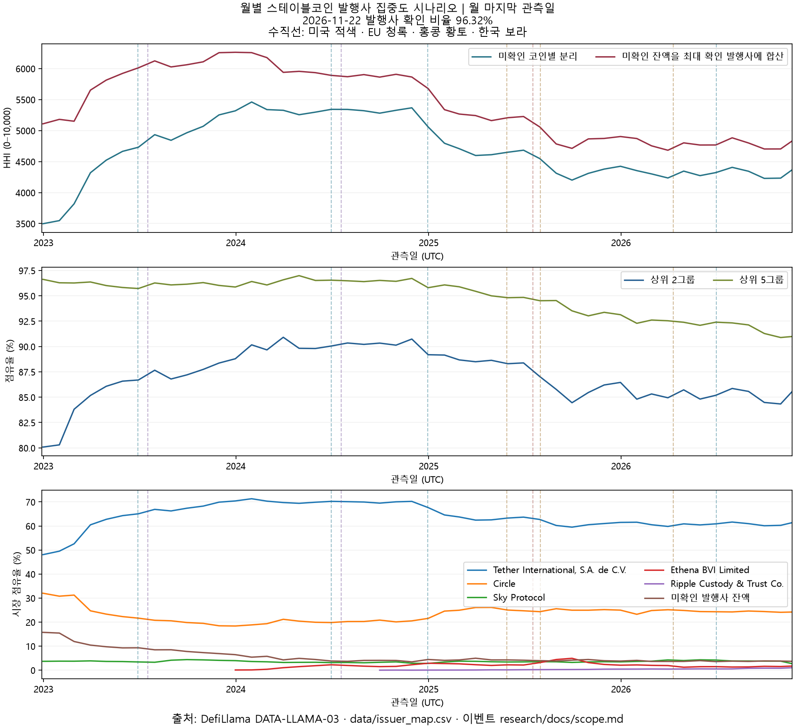
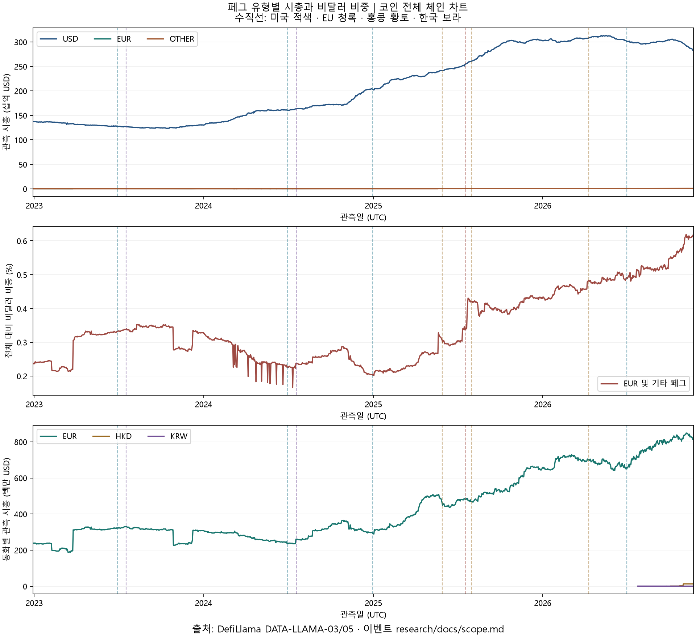

# 스테이블코인 규제와 발행·유통 구조

미국 · EU · 홍콩 · 한국 비교 연구 | **분석 기준일 2026-11-22**

[최종 보고서](reports/report.md) · [PDF](reports/report.pdf) · [한국 은행·핀테크 시사점](reports/implications_final.md)

## 1. 프로젝트 개요 및 핵심 요약

이 연구는 발행 자격, 준비자산과 상환 의무, 이자 제한의 차이가 은행과 핀테크의 발행·수탁·유통 역할에 어떤 선택지를 만드는지 비교한다. 법령·감독 문서, 공개 사업 사례, DefiLlama 시계열을 함께 검토했다. [연구 범위](research/docs/scope.md)

- 미국의 복수 발행 경로, EU의 기관 자격 요건, 홍콩의 별도 인가제는 은행과 비은행이 발행에 참여하는 조건을 다르게 설정한다. [US-01, EU-01, HK-01]
- 발행과 고객 접점은 분업할 수 있다. PayPal·Paxos는 발행과 유통을 나눴고, HSBC 홍콩은 발행 인가를 받아 기존 결제 앱을 유통에 활용했다. [CASE-S03, CASE-S05, HK-06, CASE-S14]
- 관측 시장의 발행사 집중도는 높고 비달러 비중은 작다. MiCA 적용 전후 EUR와 USD 시총 변동률 차이는 관측 기간에 따라 방향이 달라진다. [EU-01, DATA-LLAMA-03, DATA-LLAMA-05]
- 한국은 최종 발행 자격과 시행일이 미확인 상태다. 은행은 예금토큰 실증과 제휴 가능성을, 핀테크는 가맹점 결제·정산과 지갑 연동의 사업성을 검토할 수 있다. [KR-04, KR-06, KR-07, KR-14, CASE-S03, CASE-S06, CASE-S16]

## 2. 4개 관할권 스테이블코인 규제 비교

| 관할권 | 법령·가이드라인과 상태 | 발행사 인가 요건 | 준비자산·상환 | 이자 지급 제한 | 감독 체계 |
|---|---|---|---|---|---|
| 미국 | GENIUS Act는 2025-07-18 제정. OCC 최종규칙이 명시한 시행 예정일은 2027-01-18. [US-01, US-02] | 예금취급기관 자회사, 연방 적격 또는 주 적격 발행인 경로. [US-01] | 최소 1대1 준비자산. OCC 감독 대상의 유효 상환 요청은 원칙적으로 2영업일 내 처리. [US-01, US-02] | 허용 발행인 및 해외 발행인의 보유·사용·유지 관련 이자·수익 지급 제한. [US-01] | 발행인 유형별 연방·주 감독. [US-01] |
| EU | MiCA 발효 2023-06-29, ART·EMT 부분 적용 2024-06-30, 일반 적용 2024-12-30. [EU-01] | 전자화폐토큰(EMT)의 공개 제공·상장은 신용기관 또는 전자화폐기관 인가 필요. [EU-01] | EMT 수취자금의 최소 30%를 신용기관 별도계좌에 두고 요청 시 액면 상환. 자산준거토큰(ART)은 준비자산 분리 및 상시 상환권 적용. [EU-01] | ART·EMT 발행인과 관련 암호자산서비스제공자(CASP)에 이자 금지 적용. [EU-01] | 중요 토큰 분류에 따라 유럽은행감독청(EBA)과 회원국 기관의 감독 범위가 달라짐. [EU-01, EU-07] |
| 홍콩 | Stablecoins Ordinance 서명 2025-05-29, 시행 2025-08-01. 등록부상 첫 인가 발효 2026-04-10. [HK-01, HK-02, HK-06] | 별도 발행 인가 필요. [HK-01] | 감독 지침은 토큰별 준비금 풀 분리와 유효한 액면 상환 요청의 원칙적 1영업일 내 처리를 요구. [HK-03] | 발행인이 이자를 지급하거나 지급을 허용하는 행위를 규율. [HK-03] | Monetary Authority가 인가·감독. [HK-01] |
| 한국 | 민병덕안·안도걸안은 발의 문안 기준이며 최신 공식 처리 상태와 확정 시행일은 **UNVERIFIED**. 정부안 공식 전문·제출·시행일은 **UNVERIFIED**이며 확인한 정부 자료는 협의 단계까지 뒷받침. [KR-04, KR-05, KR-06, KR-07, KR-14, KR-15] | 금융위 인가 제안. 민병덕안은 국내 설립 법인, 안도걸안은 주식회사·일정 금융기관 등에 신청 경로 제안. [KR-06, KR-07] | 민병덕안은 환불·환불준비금 계획 심사, 안도걸안은 준비자산 분리 예치·신탁과 상환 기한 제안. [KR-06, KR-07] | 민병덕안의 명시적 보유 이자 조항은 원문에서 확인되지 않아 **UNVERIFIED**. 안도걸안은 발행인 부담의 보유 연동 할인·적립금도 이자로 제안. [KR-06, KR-07] | 두 의원안 모두 금융위 중심. 민병덕안은 금감원 검사와 한은 자료 요구, 안도걸안은 관계기관 협의·검사 요청 절차를 제안. [KR-06, KR-07] |

발행 자격은 누가 토큰 채무를 질 수 있는지를 정하고, 준비금 분리와 상환 기한은 발행사와 수탁은행이 계약에서 정해야 할 자금 이체·유동성 조건에 영향을 줄 수 있다. 이자 제한은 발행사와 유통사가 고객 혜택을 설계할 때 지급 조건과 재원을 함께 보게 한다. [규제 매트릭스 및 조문 인용](research/regulation/matrix.csv) · [설계 차이 해설](research/regulation/matrix_notes.md)

## 3. 주요 사업모델과 시장 데이터

| 사례 | 발행·유통·정산 구조 |
|---|---|
| Circle · USDC | Circle이 발행하고 Circle Mint, 거래소, 지갑 제휴로 유통한다. 준비자산 수익이 사업모델에 포함된다. [CASE-S01, CASE-S02] |
| PayPal·Paxos · PYUSD | Paxos가 발행하고 PayPal이 고객 접점을 제공한다. 준비자산 수익 배분은 공개 자료에서 확인되지 않아 **UNVERIFIED**. [CASE-S03, CASE-S05] |
| Stripe | 고객은 지갑으로 구독료를 내고 가맹점은 법정화폐로 정산받는다. 구독 프리뷰 개별 요율은 공개 자료에서 확인되지 않아 **UNVERIFIED**. [CASE-S06, CASE-S07] |
| J.P. Morgan · JPMD | 기관용 예금토큰을 공개 체인에서 이용하고 은행 인프라 안에서 현금과 전환한다. [CASE-S08, CASE-S09] |
| SG-FORGE · EUR CoinVertible | 유로 연동 토큰을 공개 체인과 거래소를 통해 유통한다. [CASE-S10, CASE-S11, CASE-S12, CASE-S13] |
| HSBC 홍콩 · RedCoin | 별도 발행 인가를 받은 은행이 기존 PayMe 앱을 유통에 활용한다. [HK-06, CASE-S14] |
| 프로젝트 한강 | 참가은행 예금토큰 실증에서 은행 지갑과 지정 가맹점을 연결했다. [CASE-S16, CASE-S17, CASE-S19] |

[공개 근거와 사례별 비교](research/cases/cases.md) · [사례 데이터](research/cases/cases.csv)

### 시장 집중도



2026-11-22 UTC의 전체 체인 관측 시총에서 확인 발행사 커버리지는 **96.32%**였다. 미확인 코인을 개별 그룹으로 뒀을 때 상위 두 그룹의 점유율은 **85.57%**, HHI는 **4,367.95**였다. 미확인 잔액을 최대 확인 발행사에 합산한 HHI는 **4,833.21**였다. 정확한 전수 집중도는 나머지 발행사를 식별하지 못해 **UNVERIFIED**다. 현재 발행사 매핑을 과거 관측에도 적용했으므로 사업 승계나 지역별 발행 구조에 따라 과거 값이 달라질 수 있다. [DATA-LLAMA-03, DATA-LLAMA-05]

### 비달러 스테이블코인



같은 관측일에 분석상 비달러 묶음은 전체 관측 시총의 **0.62%**였다. MiCA 부분 적용 전후 EUR 페그 시총 변동률에서 USD 페그 변동률을 뺀 값은 ±90일에 **+4.24%p**, ±180일에 **−7.06%p**로 방향이 바뀌었다. 규제 일정과 시장 움직임의 시기적 비교이며 인과관계는 식별할 수 없다. 신규 발행·상장, 달러 환산 환율, 공통 시장 사이클과 USD 시장의 규제 노출도 결과에 영향을 줄 수 있다. 페그 통화는 토큰이 참조하는 통화이며 보유자 소재지는 자료 범위 밖이다. [EU-01, DATA-LLAMA-03, DATA-LLAMA-04, DATA-LLAMA-05] [결과표](analysis/results.md) · [분석 한계](analysis/limitations.md)

## 4. 한국 은행·핀테크에 대한 전략적 시사점

| 단계 | 은행 | 핀테크 |
|---|---|---|
| 지금 · 결제 수요 확인 | 참여자와 사용처가 정해진 기업 결제·가맹점에서 예금토큰 활용, 현금 전환, 정산 절차를 검토한다. [CASE-S08, CASE-S09, CASE-S16, CASE-S17] | 가맹점의 지갑 결제·법정화폐 정산 수요, 추가 수수료 지불 의사, 처리·지원 비용을 검증한다. 해외 사례를 바탕으로 한 가설이다. [CASE-S06, CASE-S07] |
| 요건 구체화 · 제휴 설계 | 준비금 보관, 상환 자금 이체, 고객 문의·청구 접수의 담당 주체를 계약에 명시하는 수탁·유통 모델을 검토한다. [KR-07, EU-01, CASE-S03] | 지갑 연동·결제 처리 등 제공하는 서비스의 대가를 협의하고, 보유 연동 혜택은 재원과 지급 조건을 점검한다. [CASE-S03, CASE-S05, KR-07, EU-01] |
| 인가 확정 후 · 발행 판단 | 인가 자격을 충족하고 반복 결제 수요에서 준비금·상환·운영 비용을 감당할 수 있을 때 직접 발행을 검토한다. [KR-06, KR-07, HK-06, CASE-S14] | 확정된 발행 자격과 유통 규정에 따라 자체 발행 가능성과 인가 발행사 제휴의 비용·책임을 비교한다. [KR-04, KR-06, KR-07, KR-14] |

국내 발행 자격과 시행일, 가맹점의 수수료 지불 의사, 은행 간 정산과 외부 지갑 연결 요건이 이 판단을 바꿀 수 있다. 한국 의원안에 기댄 발행·수탁 시나리오와 해외 사례에 기댄 국내 핀테크 수익 가설은 근거가 약하다. [전략별 근거와 성립 조건](reports/implications_final.md)

<details><summary>📂 저장소 구조 및 분석 재현 가이드 펼치기</summary>

## 5. 저장소 구조 및 데이터 재현 방법

```text
.
├── reports/             최종 보고서, PDF, 한국 시사점
├── research/
│   ├── regulation/      규제 매트릭스와 해설
│   ├── cases/           사례 비교와 근거
│   ├── sources/         출처 대장
│   └── docs/            연구 범위와 데이터 정의
├── analysis/            수집·정제·분석 스크립트와 결과표
├── data/                정제 데이터와 발행사 매핑
├── assets/figures/      보고서 차트
└── logs/                수집·감사 기록
```

저장소 루트에서 Python 3.10 이상을 사용한다. 배포된 정제 데이터로 결과표와 차트를 재생성하려면 다음을 실행한다.

```powershell
python -m pip install -r requirements.txt
python analysis/03_concentration.py
python analysis/04_nonusd.py --render-figure
```

DefiLlama API에서 다시 수집하려면 `curl`이 필요하다. 새 원자료에는 실제 수집일을 지정한다. 날짜 인자는 API의 과거 응답을 복원하는 기능을 제공하지 않는다. 기존 시점의 원자료와 매니페스트를 별도 보관했다면 `data/raw/defillama/2026-11-22/`에 둔 뒤 당시 날짜를 사용해 정제할 수 있다. 새 정제는 기존 CSV를 갱신하므로 보존이 필요하면 별도 체크아웃에서 실행한다. 새 스냅샷 분석 전에는 상위 코인 발행사 매핑을 공식 근거와 대조해 갱신한다. [상세 실행 순서](analysis/README.md)

```powershell
$snapshotDate = Get-Date -Format yyyy-MM-dd
python analysis/01_collect.py --snapshot-date $snapshotDate
python analysis/02_clean.py --snapshot-date $snapshotDate
```

- **법령·감독 문서·공시**는 출처 대장의 `source_id`, `url`, `retrieved_date`로 추적한다. 조문과 짧은 원문 인용은 규제 매트릭스의 `source_quote`에 있다. [출처 대장](research/sources/sources.csv) · [규제 매트릭스](research/regulation/matrix.csv)
- **시장 데이터**는 DefiLlama 코인 목록·상세·전체 체인 차트·과거 가격 응답을 사용한다. 월별 값은 UTC 월의 마지막 유효 관측치다. 마지막 달은 분석 기준일까지의 관측이다. [DATA-LLAMA-01, DATA-LLAMA-02, DATA-LLAMA-03, DATA-LLAMA-04, DATA-LLAMA-05] [데이터 정의](research/docs/data_notes.md) · [수집 요약](data/processed/stablecoin_collection_summary.json) · [발행사 매핑](data/issuer_map.csv)
- **로컬 원자료**인 `data/raw/`와 `research/sources/raw/`는 Git에서 제외한다. 검증 범위와 미확인 항목은 감사 기록과 최종 보고서 부록에서 확인할 수 있다. [감사 기록](logs/) · [최종 보고서](reports/report.md)

</details>
