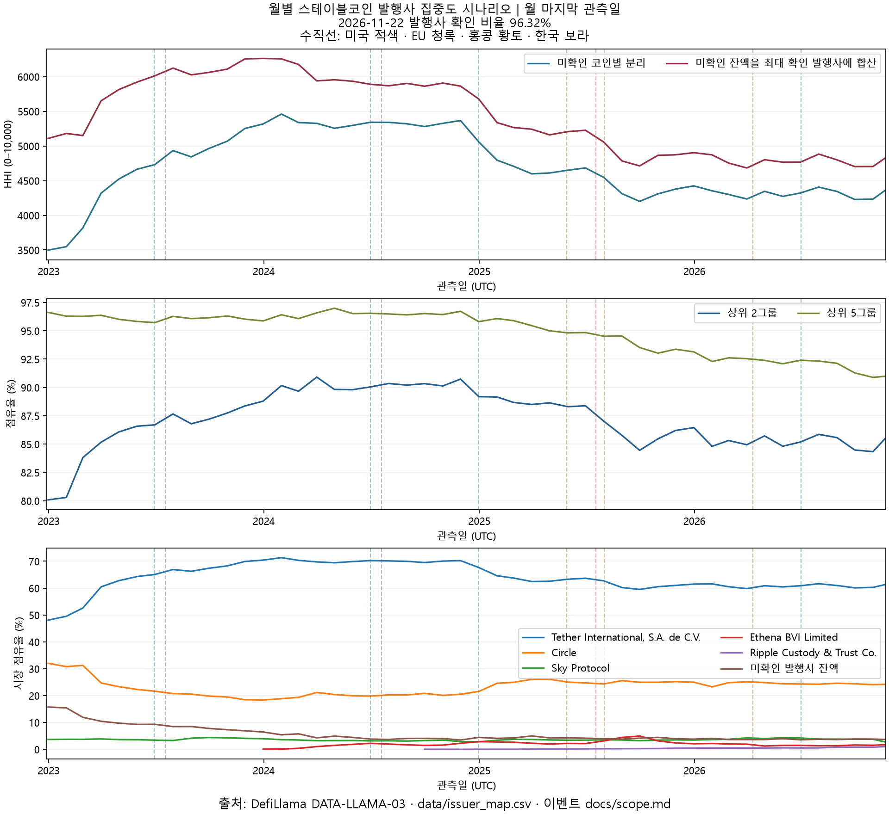
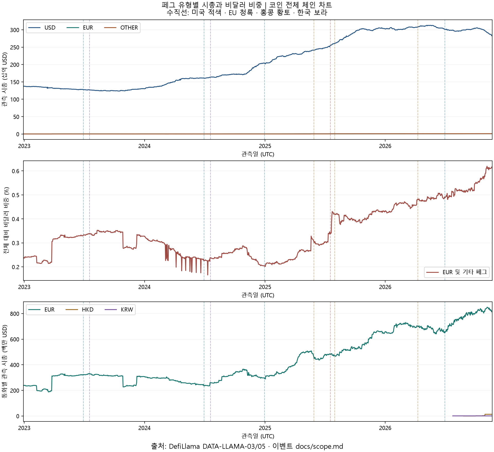

# 스테이블코인 규제와 발행·유통 구조

미국·EU·홍콩·한국 비교 | 규제 정보 기준일 2026-11-22

## 요약

미국, EU, 홍콩은 발행 인가의 진입 경로와 준비금·상환 의무를 서로 다르게 배치한다. 미국은 은행 자회사와 연방·주 적격 발행인 경로를 두며, EU는 전자화폐토큰(EMT) 발행 자격을 신용기관과 전자화폐기관에 연결한다. 홍콩은 별도의 발행 인가를 운영한다. 이 차이는 은행과 핀테크가 발행, 준비금 보관, 고객 접점 중 어떤 역할을 함께 맡거나 계약으로 나눌 수 있는지에 영향을 줄 수 있다. [US-01, US-02, EU-01, HK-01, HK-02]

한국은 2026-11-22 기준 정부안 미공개로 처리했다. 확인한 공식 자료에는 협의와 검토가 나타나며, 정부안의 공식 전문·국회 제출·확정 시행일은 UNVERIFIED다. 공개된 의원안은 별도로 비교했다. 한국 은행에는 직접 발행, 예금토큰, 수탁·유통 제휴가 조건부 선택지다. 핀테크의 결제·정산 및 지갑·유통 수익은 해외 사례에서 관찰한 사업 가설이다. [KR-04, KR-05, KR-06, KR-07, KR-14, KR-15, CASE-S03, CASE-S06, CASE-S16]

시장에서는 발행사 집중이 관찰되지만 정확한 전수 집중도는 UNVERIFIED다. MiCA 적용 전후의 EUR·USD 시총 변동률 차이도 비교 기간에 따라 방향이 바뀐다. 사례와 시계열은 사업 구조와 시장 움직임을 설명하는 데 사용했다. [EU-01, DATA-LLAMA-03, DATA-LLAMA-05]

## 연구 질문과 방법

발행 자격, 준비금·상환 의무, 은행의 역할이 발행사와 유통사의 업무 배분과 어떻게 연결되는가? 법령과 감독기관 문서를 우선하여 [규제 매트릭스](../regulation/matrix.csv)에 상태·시행일·원문 인용을 기록했다. [사업 사례](../cases/cases.csv)는 공개 문서에서 확인한 발행·정산·유통 역할을 비교했다. 시장 관찰에는 DefiLlama 전체 체인 시총의 월별 마지막 유효 관측치와 이벤트 전후 일평균을 사용했다. [DATA-LLAMA-02, DATA-LLAMA-03, DATA-LLAMA-04, DATA-LLAMA-05]

<!-- page -->

## 규제 비교

| 관할권 | 상태와 시행·적용 | 발행 경로 | 준비금·상환 |
|---|---|---|---|
| 미국 | GENIUS Act 2025-07-18 제정. OCC 최종규칙 2027-01-18 시행. [US-01, US-02] | 은행 자회사, 연방·주 적격 발행인 [US-01] | 최소 1대1 준비금. OCC 감독 대상의 유효 요청은 원칙적으로 2영업일 이내 처리. [US-01, US-02] |
| EU | MiCA ART·EMT 2024-06-30 부분 적용, 2024-12-30 일반 적용. [EU-01] | EMT는 신용기관·전자화폐기관 [EU-01] | EMT 수취자금 최소 30% 별도계좌, 요청 시 액면 상환. ART는 준비자산 분리 및 상시 상환권. [EU-01] |
| 홍콩 | 조례 2025-08-01 시행. 등록부상 첫 인가 2026-04-10 발효. [HK-01, HK-02, HK-06] | 별도 발행 인가 [HK-01] | 토큰별 준비금 풀 분리. 유효한 액면 상환 요청은 원칙적으로 1영업일 이내 처리. [HK-03] |
| 한국 | 정부안 공식 전문·제출·시행일 UNVERIFIED. 의원안은 발의 문안이며 확정 시행일 UNVERIFIED. [KR-04, KR-05, KR-06, KR-07, KR-14, KR-15] | 민병덕안은 국내 설립 법인, 안도걸안은 주식회사·일정 금융기관 등에 신청 경로 제안. [KR-06, KR-07] | 민병덕안은 환불 및 준비금 계획 심사, 안도걸안은 준비자산 분리 예치·신탁과 상환 기한 제안. [KR-06, KR-07] |

1. **발행 자격.** 미국의 복수 인가 경로, EU EMT의 기관 자격, 홍콩의 별도 인가에 따라 은행·비은행이 발행을 맡는 경로가 달라진다. [US-01, EU-01, HK-01]
2. **준비금 보관.** EU EMT의 별도계좌, 홍콩의 토큰별 풀, 안도걸안의 지정 기관 예치·신탁은 수탁 계약의 범위가 달라질 수 있음을 보여준다. [EU-01, HK-03, KR-07]
3. **상환.** EU EMT는 요청 시 액면 지급을 규정한다. OCC 규칙과 홍콩 지침은 각각의 감독 범위 안에서 요청 처리 기한을 제시한다. [EU-01, US-02, HK-03]
4. **이자와 혜택.** 미국은 대상 발행인의 이자·수익 지급을 제한하고, EU는 관련 서비스제공자에도 이자 금지를 적용한다. 안도걸안은 발행인 부담의 보유 연동 혜택을 포함한다. [US-01, EU-01, KR-07]
5. **은행 역할.** 미국에서는 승인 자회사가, 홍콩에서는 별도 인가를 받은 은행이 발행에 참여할 수 있다. EU 신용기관은 발행과 더불어 별도계좌 등도 제공할 수 있다. [US-01, HK-01, HK-06, EU-01]

## 사업모델 사례 비교

| 사례 | 발행·상품 | 유통·정산 또는 수익 구조 |
|---|---|---|
| C01 Circle | USDC 발행 | Circle Mint·거래소·지갑 제휴, 준비자산 수익 [CASE-S01, CASE-S02] |
| C02 PayPal·Paxos | Paxos가 PYUSD 발행 | PayPal이 고객 접점 제공, 준비자산 수익 배분 UNVERIFIED [CASE-S03, CASE-S05] |
| C03 Stripe | 지갑 기반 구독 결제 | 가맹점의 법정화폐 정산, 프리뷰 개별 요율 UNVERIFIED [CASE-S06, CASE-S07] |
| C04 J.P. Morgan | 기관용 JPMD 예금토큰 | 은행 인프라의 현금 전환과 공개 체인 이용 [CASE-S08, CASE-S09] |
| C05 SG-FORGE | EUR CoinVertible | 공개 체인 유통과 거래소 상장 [CASE-S10, CASE-S11, CASE-S12, CASE-S13] |
| C06 HSBC 홍콩 | 인가 발행 RedCoin | 기존 PayMe 앱을 유통 채널로 사용 [HK-06, CASE-S14] |
| C07 프로젝트 한강 | 참가은행 예금토큰 실증 | 참가은행 지갑과 지정 가맹점 연결 [CASE-S16, CASE-S17, CASE-S19] |

<!-- page -->

## 데이터 관찰

**발행사 집중도.** 2026-11-22 관측에서 확인 발행사 커버리지는 96.32%였다. 미확인 코인을 분리한 HHI는 4,367.95, 최대 확인 발행사에 합산한 HHI는 4,833.21이었다. 정확한 전수 HHI는 UNVERIFIED다. 현재 발행사 매핑을 과거에 적용해 발행 주체 승계나 지역별 구조를 놓칠 수 있다. [DATA-LLAMA-03, DATA-LLAMA-05]

**비달러 시장.** 같은 관측에서 분석의 비달러 합계 비중은 0.62%였다. MiCA 부분 적용 전후 EUR 시총 증가율에서 USD 시총 증가율을 뺀 값은 ±90일에 +4.24%p, ±180일에 −7.06%p였다. 창 중첩, 신규 발행·상장, 환율과 공통 시장 사이클로도 설명될 수 있다. USD 시장도 규제에 노출될 수 있다. [EU-01, DATA-LLAMA-03, DATA-LLAMA-04, DATA-LLAMA-05]

<!-- page -->

# 한국 은행·핀테크에 대한 스테이블코인 시사점

**기준일 및 출처 확인일 2026-11-22.** 금융위는 은행 중심 발행 구조를 논의했고, 발행주체 등 주요 내용이 확정되지 않았다고 설명했다. 정부안의 공식 전문·제출 확인은 `UNVERIFIED`다. 공식 보도자료는 협의 사실을 뒷받침한다. [source: KR-04, KR-14]

민병덕안은 발의 문안, 안도걸안은 발의 문안과 정무위 검토보고를 기준으로 한다. 양안의 확정 시행일은 `UNVERIFIED`다. 아래에서 한국 의원안의 조항에 기대는 시나리오는 **근거 약함**으로 표시했다. [matrix: KR/licensing_status] [source: KR-06, KR-07, KR-15]

**요약.** (1) 은행: 국내 발행 자격과 시행일이 확정되지 않아 직접 발행·수탁·유통은 요건이 확정된 뒤에 판단할 수 있다. 현재 근거가 상대적으로 구체적인 영역은 예금토큰 실증(프로젝트 한강, JPMD)이다. (2) 핀테크: 한국 사업 사례가 없어 결제 처리·정산 수수료와 지갑·유통 대가를 수익원 후보로만 두며, 근거는 약하다. (3) 규제: 가장 큰 쟁점은 발행 자격(은행 중심 또는 복수 경로)이고, 그다음은 준비금 분리와 상환 기한의 구체성이다.

## Q1. 한국 은행은 직접 발행에 나설 것인가, 예금토큰·수탁·유통 파트너로 갈 것인가?

**1. 직접 발행이 허용되고 반복적인 결제 수요가 있으면 발행을 검토할 수 있다.** 은행이 발행 자격을 충족하고, 약정된 상환을 감당할 유동성과 자체 유통 채널을 확보한다면 발행과 유통을 함께 운영할 수 있다. 홍콩에서는 별도 발행 인가를 받은 HSBC가 기존 PayMe 앱으로 RedCoin을 출시했다. 국내 적용 시에는 기존 고객 접점에서 발생하는 반복 결제 수요가 준비금 운용·상환 대응·시스템 운영 비용을 감당할 수 있는지를 봐야 한다. **근거 약함(국내 발행 자격과 시행일)**. [matrix: KR/issuer_eligibility] [matrix: HK/bank_role] [case: C06] [source: KR-06, KR-07, HK-01, HK-03, HK-06, CASE-S14]

**2. 예금 고객과 정해진 결제망이 주된 대상이면 예금토큰을 검토할 수 있다.** 기업 결제나 지정 가맹점처럼 참여자와 사용처를 정할 수 있고 예금과 토큰을 오가는 절차가 마련된다면, 은행은 예금토큰으로 결제 수요를 확인할 수 있다. 프로젝트 한강은 참가은행 지갑과 가맹점을 연결한 실증이고, JPMD는 기관 고객이 은행 인프라 안에서 예금토큰을 현금과 전환하는 해외 사례다. 실증 범위를 넘어설 때는 은행 간 정산과 외부 지갑 연결이 가능한지에 따라 적용할 업무가 달라질 수 있다. [case: C07] [case: C04] [source: CASE-S16, CASE-S17, CASE-S19, CASE-S08, CASE-S09]

**3. 제휴 발행사가 상환을 맡고 은행이 보관·고객 접점에 강점이 있으면 수탁·유통 파트너가 될 수 있다.** 안도걸안처럼 지정 금융기관에 준비자산을 분리 예치·신탁하는 구조가 채택되면 은행은 보관과 상환 자금 이체를 계약에 담을 수 있다. 은행 앱으로 유통까지 맡는다면 발행사의 상환 책임과 은행의 고객 문의·청구 접수 역할을 구분해 계약할 수 있다. EU의 은행 별도계좌와 PayPal·Paxos의 발행·유통 분업이 각각의 비교 사례다. **근거 약함(국내 예치·신탁 요건과 시행일)**. [matrix: KR/bank_role] [matrix: EU/bank_role] [case: C02] [source: KR-07, EU-01, CASE-S03]

## Q2. 한국 핀테크의 수익 원천은 어디에 있는가?

**근거 약함.** 사례 목록에 한국 핀테크 사업 사례가 없어 아래 두 시나리오는 Stripe와 PayPal·Paxos 등 해외 사례에 기댄다. 국내 가격, 마진, 수익 배분은 해당 사례로 확인할 수 없다. [case: C02] [case: C03] [source: CASE-S03, CASE-S05, CASE-S06, CASE-S07]

**1. 가맹점이 지갑 결제와 법정화폐 정산을 함께 원하면 결제 처리·정산이 수익 후보가 된다.** Stripe는 고객이 지갑으로 구독료를 내고 가맹점이 법정화폐를 받는 구조를 공개했다. 표준 스테이블코인 결제 요금표는 공개돼 있고 구독 프리뷰의 개별 요율은 `UNVERIFIED`다. 국내에서 가맹점이 기존 결제수단에 더해 이 기능에 비용을 지불하고, 결제 처리·정산·고객지원 비용을 수수료로 충당할 수 있다면 거래 기반 수익을 검토할 수 있다. **근거 약함(해외 요금 체계의 국내 적용)**. [case: C03] [source: CASE-S06, CASE-S07]

**2. 인가 발행사가 준비금과 상환을 맡고 핀테크가 고객 접점을 제공하면 지갑·유통 계약이 수익 후보가 된다.** PYUSD에서 Paxos가 발행을 맡고 PayPal이 송금 등 고객 접점을 제공했다. PayPal에 귀속되는 준비자산 수익 배분은 `UNVERIFIED`이므로, 배분 계약이 확인되기 전에는 지갑 연동·결제 처리 등 실제 제공하는 서비스에 대가를 받을 수 있는지가 판단 기준이다. 안도걸안처럼 발행인 부담의 보유 연동 할인·적립금까지 이자로 본다면 혜택을 설계할 때 재원과 지급 조건을 함께 확인해야 한다. EU는 관련 암호자산서비스제공자에도 이자 금지를 적용한다. **근거 약함(해외 분업의 국내 적용, 국내 혜택 제한과 시행일)**. [case: C02] [matrix: KR/interest_yield] [matrix: EU/interest_yield] [source: CASE-S03, CASE-S05, KR-07, EU-01]

## Q3. 한국 규제 설계에서 가장 큰 쟁점은 무엇이며, 해외 설계와 비교하면 어떤 트레이드오프가 있는가?

**1. 발행 자격을 은행 중심으로 좁히면 발행·상환 책임을 은행 중심으로 배치할 수 있고, 비은행에도 열면 독자 발행과 제휴 선택지가 넓어질 수 있다.** 이 선택이 은행과 핀테크의 역할을 직접 가르므로 가장 큰 쟁점으로 봤다. 금융위는 은행 중심 구조를 논의했다. 민병덕안은 국내 설립 법인에, 안도걸안은 주식회사·일정 금융기관·국내 영업소를 둔 외국 법인 등에 인가 신청 경로를 제안한다. 미국 GENIUS Act는 은행 자회사와 연방·주 적격 발행인 경로를 두는 제정법이며, OCC 최종규칙은 시행일을 2027-01-18로 명시한다. EU에서 시행 중인 MiCA는 전자화폐토큰(EMT)의 공개 제공·상장에 신용기관 또는 전자화폐기관 인가를 요구한다. 홍콩은 별도 발행 인가제 시행 중이다. 은행 중심이면 핀테크가 발행 계약에 의존할 수 있고, 복수 경로를 두면 발행인 유형별로 준비금·상환 요건을 일관되게 집행할 수 있어야 한다. **근거 약함(국내 발행 자격과 시행일)**. [matrix: KR/issuer_eligibility] [matrix: US/issuer_eligibility] [matrix: US/licensing_status] [matrix: EU/issuer_eligibility] [matrix: HK/issuer_eligibility] [matrix: HK/licensing_status] [source: KR-04, KR-06, KR-07, US-01, US-02, EU-01, HK-01, HK-02]

**2. 준비금 분리 방식과 상환 기한을 구체화하면 보유자가 청구 절차를 예측하기 쉬워지고, 세부 기준을 인가 심사에 맡기면 사업별 설계 여지가 커질 수 있다.** 민병덕안은 환불 방법과 환불준비금 계획을 인가에서 심사하고, 안도걸안은 준비자산 분리 예치·신탁과 원칙적인 상환 지급 기한을 제안한다. EU EMT는 요청 시 액면가 상환을 요구하고 홍콩은 토큰별 준비금 풀을 분리한다. 국내에서 보관과 지급 조건을 구체화하면 발행사와 수탁은행이 상환 자금 이체 기준을 맞추기 쉬워질 수 있다. 요건이 촘촘할수록 발행사는 단기간 청구에 대비해 유동성을 확보해야 하고, 인가 계획 중심이면 유통사가 발행인별 청구 절차와 처리 시간을 확인해야 할 수 있다. **근거 약함(국내 준비금·상환 요건과 시행일)**. [matrix: KR/reserve_requirements] [matrix: KR/redemption] [matrix: EU/redemption] [matrix: HK/reserve_requirements] [source: KR-06, KR-07, EU-01, HK-03]

**비교 데이터.** MiCA 부분 적용과 일반 적용 전후 EUR 시총 변동률에서 USD 변동률을 뺀 값은 창 길이에 따라 부호가 바뀐다. ±60·90·180일 순으로 2024-06-30 부분 적용에서는 +1.91, +4.24, −7.06%p, 2024-12-30 일반 적용에서는 −10.74, −14.80, +2.59%p였다. 이는 적용 시점과의 동행 관찰이다. 창이 겹치고 길이에 따라 포함되는 시장일이 달라지며, 신규 발행·상장, 달러 환산 환율, 공통 시장 사이클과 USD 토큰의 규제 노출도 함께 작용할 수 있어 규제 효과로 해석할 수 없다. [matrix: EU/licensing_status] [data: analysis/results.md] [data: analysis/limitations.md] [source: EU-01, DATA-LLAMA-02, DATA-LLAMA-03, DATA-LLAMA-04, DATA-LLAMA-05]

## 이 시사점이 틀릴 수 있는 조건

1. 최종 인가 자격이나 은행 지분 요건이 의원안·금융위 논의와 크게 달라져 직접 발행과 제휴의 비용 및 책임 배분이 달라지는 경우. [matrix: KR/issuer_eligibility] [matrix: KR/bank_role] [source: KR-04, KR-06, KR-07, KR-14]
2. 국내 가맹점의 추가 수수료 지불 의사가 낮거나 제휴 계약에서 국내 핀테크에 귀속되는 대가가 운영비에 못 미치는 경우. [case: C02] [case: C03] [source: CASE-S03, CASE-S05, CASE-S06, CASE-S07]
3. 외부 지갑이나 은행 간 결제망과의 연결 수요가 예금토큰 실증 범위를 크게 벗어나고, 수탁·유통 계약으로도 필요한 정산을 제공하기 어려운 경우. [case: C04] [case: C07] [matrix: KR/bank_role] [source: CASE-S08, CASE-S16, CASE-S17, KR-07]

## 연구의 한계

- **한국 입법.** 2026-11-22 기준 정부안 미공개로 처리했다. 공식 전문과 정부 제출 여부, 확정 시행일은 UNVERIFIED다. 의원안과 금융위 협의 자료를 바탕으로 한 국내 사업 구조는 조건부다. [KR-04, KR-05, KR-06, KR-07, KR-14, KR-15]
- **사례의 범위.** 공개 제품 자료는 사업 구조를 보여 준다. 국내 핀테크의 수익성, 개별 요율이나 수익 배분은 UNVERIFIED다. [CASE-S03, CASE-S05, CASE-S06, CASE-S07]
- **데이터와 식별.** 페그 통화로 보유자·발행사 소재지를 식별할 수 없다. 코인 누락, 환율과 공통 시장 요인이 시총에 영향을 줄 수 있다. 인과 추정과 통계 검정은 수행하지 않았다. [DATA-LLAMA-02, DATA-LLAMA-03, DATA-LLAMA-04, DATA-LLAMA-05]

<!-- page -->

## 참고문헌

전체 문헌의 제목·발행기관·원문 URL·확인일은 [출처 대장](../sources/sources.csv)에 있다. 규제 조문의 짧은 원문 인용은 [규제 매트릭스](../regulation/matrix.csv)의 `source_quote`를 참조한다.

- [US-01](https://www.govinfo.gov/content/pkg/PLAW-119publ27/html/PLAW-119publ27.htm) · [US-02](https://www.govinfo.gov/content/pkg/FR-2026-10-23/html/2026-21706.htm) · [US-10](https://www.govinfo.gov/content/pkg/FR-2026-11-09/html/2026-22809.htm)
- [EU-01](https://eur-lex.europa.eu/eli/reg/2023/1114/oj/eng) · [EU-05](https://www.esma.europa.eu/sites/default/files/2026-04/ESMA75-113276571-1679_Statement_on_the_end_of_transitional_periods_under_MiCA.pdf)
- [HK-01](https://www.legco.gov.hk/yr2025/english/ord/2025ord017-e.pdf) · [HK-02](https://www.legco.gov.hk/yr2025/english/subleg/negative/2025ln125-e.pdf) · [HK-03](https://www.hkma.gov.hk/media/eng/doc/key-functions/ifc/stablecoin-issuers/Guideline_on_supervision_of_licensed_stablecoin_issuers_eng.pdf) · [HK-06](https://www.hkma.gov.hk/eng/regulatory-resources/registers/register-of-licensed-stablecoin-issuers/)
- [KR-04](https://www.fsc.go.kr/po010101/86373) · [KR-05](https://www.fsc.go.kr/no010102/87600) · [KR-06](https://likms.assembly.go.kr/bill/billDetail.do?billId=PRC_T2R5S0Q6P0P5X0Y9W1W1V3V0U7C4C1) · [KR-07](https://likms.assembly.go.kr/bill/billDetail.do?billId=PRC_K2L5J0I7I2G8H0C9D0B9C3A7B5Z3A7) · [KR-14](https://www.fsc.go.kr/no010102/85997) · [KR-15](https://likms.assembly.go.kr/filegate/servlet/FileGate?bookId=FC4FBBEB-F60B-816A-5AC0-F6BD0AB6BD9A&type=1)
- [CASE-S01](https://www.sec.gov/Archives/edgar/data/1876042/000187604226000062/crcl-20251231.htm) · [CASE-S03](https://newsroom.paypal-corp.com/2023-08-07-PayPal-Launches-U-S-Dollar-Stablecoin) · [CASE-S06](https://stripe.com/blog/introducing-stablecoin-payments-for-subscriptions) · [CASE-S08](https://www.jpmorgan.com/payments/newsroom/jpm-coin-usd-deposit-token-institutional-clients) · [CASE-S12](https://www.sgforge.com/wp-content/uploads/2025/10/EURCV-White-Paper_iXBRL_202510.html) · [CASE-S14](https://www.about.hsbc.com.hk/news-and-media/hsbc-redcoin-launches-today) · [CASE-S16](https://www.bok.or.kr/portal/bbs/P0000596/view.do?menuNo=200452&nttId=10097176)
- [DATA-LLAMA-02](https://stablecoins.llama.fi/stablecoin/1) · [DATA-LLAMA-03](https://stablecoins.llama.fi/stablecoincharts/all?stablecoin=1) · [DATA-LLAMA-04](https://stablecoins.llama.fi/stablecoinprices) · [DATA-LLAMA-05](https://stablecoins.llama.fi/stablecoins?includePrices=true)

## 부록 · 확인 불가 항목

관할권·비교항목·출처 ID로 대조했다. 감사표 FAIL 7개 중 매트릭스에 없는 행은 0개다. 매트릭스 UNVERIFIED 11개 중 4개는 감사표에 FAIL로 기록되지 않았다. 아래는 해당 매트릭스 행 전체다.

| 항목 | 출처 ID | 값 · 감사 기록 | 미확인 이유 |
|---|---|---|---|
| KR/interest_yield | KR-06 | UNVERIFIED · FAIL | 발의문에서 명시적 보유 이자 조항 미확인 |
| KR/aml_travel_rule | KR-06 | UNVERIFIED · FAIL 미기록 | 발행인 전용 AML·이전정보 조항 미확인 |
| KR/issuer_eligibility | KR-04, KR-05, KR-14 | UNVERIFIED · FAIL | 정부안 공식 전문 및 제출 기록 미확인 |
| KR/reserve_requirements | KR-04, KR-05, KR-14 | UNVERIFIED · FAIL | 정부안 공식 전문 및 제출 기록 미확인 |
| KR/interest_yield | KR-04, KR-05, KR-14 | UNVERIFIED · FAIL | 정부안 공식 전문 및 제출 기록 미확인 |
| KR/redemption | KR-04, KR-05, KR-14 | UNVERIFIED · FAIL | 정부안 공식 전문 및 제출 기록 미확인 |
| KR/bank_role | KR-04, KR-05, KR-14 | UNVERIFIED · FAIL | 정부안 공식 전문 및 제출 기록 미확인 |
| KR/aml_travel_rule | KR-04, KR-05, KR-14 | UNVERIFIED · FAIL 미기록 | 정부안 공식 전문 및 제출 기록 미확인 |
| KR/foreign_issuer | KR-04, KR-05, KR-14 | UNVERIFIED · FAIL 미기록 | 정부안 공식 전문 및 제출 기록 미확인 |
| KR/supervisor | KR-04, KR-05, KR-14 | UNVERIFIED · FAIL 미기록 | 정부안 공식 전문 및 제출 기록 미확인 |
| KR/licensing_status | KR-04, KR-05, KR-14 | UNVERIFIED · FAIL | 정부안 공식 전문 및 제출 기록 미확인 |
